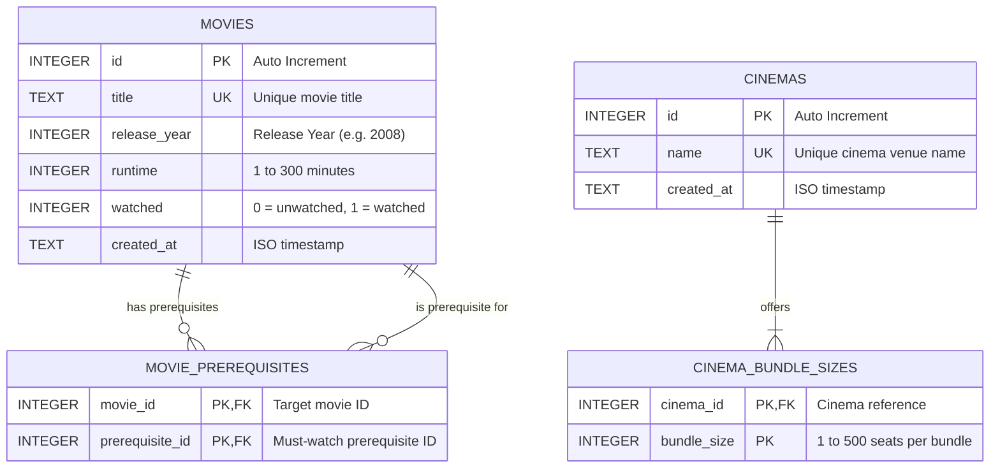
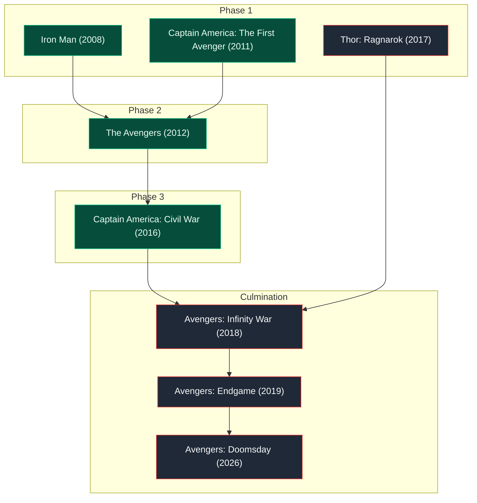

# Doomsday Ready 🎬⚡

**Doomsday Ready** is a full-stack MCU companion application built for the **Blinto Talent Accelerator 2027 Assessment**. It helps Marvel Cinematic Universe fans prepare for the premiere of *Avengers: Doomsday* by calculating optimal rewatch schedules through directed acyclic graph (DAG) topological sorting and planning watch-party ticket reservations using exact-change dynamic programming.

---

## Table of Contents

- [Features & Capabilities](#features--capabilities)
- [Architecture & Tech Stack](#architecture--tech-stack)
- [Data Model Diagram (Bonus Deliverable)](#data-model-diagram-bonus-deliverable)
- [MCU Prerequisite Dependency Graph](#mcu-prerequisite-dependency-graph)
- [Core Algorithms (Hand-Written from Scratch)](#core-algorithms-hand-written-from-scratch)
  - [1. Cycle Detection (DFS)](#1-cycle-detection-dfs)
  - [2. Rewatch Order Topological Sort (Kahn's Algorithm)](#2-rewatch-order-topological-sort-kahns-algorithm)
  - [3. Watch-Party Seat Booking (Coin-Change DP)](#3-watch-party-seat-booking-coin-change-dp)
- [API Reference](#api-reference)
- [Getting Started](#getting-started)
  - [Option A: Running with Docker Compose (Recommended Bonus)](#option-a-running-with-docker-compose-recommended-bonus)
  - [Option B: Running Locally (Node.js)](#option-b-running-locally-nodejs)
- [Test Verification Suite (15/15 Passed)](#test-verification-suite-1515-passed)
- [Project Structure](#project-structure)
- [UI & UX Highlights](#ui--ux-highlights)
- [AI Tools Usage Disclosure](#ai-tools-usage-disclosure)

---

## Features & Capabilities

### Feature 1: Movies & Rewatch Order (DAG)
- **Movie Catalog Management**: Create, edit, and delete movies with unique title, release year, runtime (1–300 minutes), and watched status.
- **Prerequisite Dependencies**: Assign prerequisite movies that must be watched before a target movie.
- **Cycle Detection**: Strictly forbids circular dependencies (e.g. $A \rightarrow B \rightarrow C \rightarrow A$) and direct self-references, returning `409 CIRCULAR_DEPENDENCY`.
- **Topological Rewatch Order**: Computes the exact transitive prerequisite chain for any movie in valid chronological order, alongside watched counts and remaining unwatched runtime in hours and minutes.

### Feature 2: Cinemas & Watch-Party Booking (Dynamic Programming)
- **Cinema Configuration**: Configure cinemas with 1 to 10 distinct seat bundle sizes (1–500 seats each).
- **Optimal Group Seating**: Calculates the minimum number of seat bundles required to match an exact group size (1–10,000 attendees) with zero empty seats paid for.
- **Exact Breakdown**: Returns bundle quantities (e.g. $20 \times 1, 9 \times 2, 6 \times 1$) or reports `"possible": false` when no combination fits.

### Feature 3: Modern Cinematic Web Application
- **Movies Dashboard**: Grid view with quick watched toggling, duration badges, prerequisite chips, and modal for adding/editing.
- **Rewatch Planner**: Dual-view system:
  - **Roadmap Timeline View**: Vertical chronological sequence with status pills and completion counters.
  - **Interactive DAG Network View**: Live SVG directed acyclic graph visualizer showing node dependencies, active target highlight, and direct watched toggling.
- **Booking Station**: Cinema selection, group size slider & stepper, preset party sizes, and **Interactive Seating Chart** theater visualizer.

### Extra Quality-of-Life Features
- **Live Doomsday Countdown**: Countdown ticker to the *Avengers: Doomsday* premiere with global preparation readiness percentage.
- **Interactive DAG Topology Visualizer**: Custom SVG node-link diagram rendering the prerequisite network.
- **Interactive Seating Chart**: Graphical cinema screen and color-coded seat clusters showing physical bundle allocation.
- **Real-Time Search & Filters**: Search by title/year, filter by Watched / Unwatched / Has Prereqs, sort by Year, Title, or Runtime.
- **Batch Mark Watched**: One-click "Mark All Prerequisites Watched" action.
- **Shareable Rewatch Schedule**: "Copy Plan" button to export formatted Markdown watch schedules to clipboard.
- **Sample Data Reset**: One-click button to reset the database to the official assessment benchmark movies and cinemas.

---

## Architecture & Tech Stack

- **Backend**: Node.js, Express 4, SQLite via `sql.js` (WebAssembly-based SQLite driver for clean cross-platform portability without native compilation dependencies).
- **Frontend**: React 18, Vite, Tailwind CSS v3 with custom design tokens, Lucide React icons, React Router v6.
- **Containerization**: Multi-stage Docker build with Nginx reverse proxy serving the frontend SPA and forwarding `/api` requests to the Node backend.
- **Zero Heavy Library Dependencies**: Cycle detection, Kahn's topological sort, and bottom-up DP coin-change are coded 100% from scratch without third-party algorithm libraries.

---

## Data Model Diagram (Bonus Deliverable)



---

## MCU Prerequisite Dependency Graph

Below is the dependency graph populated in the sample dataset:



---

## Core Algorithms (Hand-Written from Scratch)

### 1. Cycle Detection (DFS)
Located in `backend/src/services/graphService.js`:
- Before persisting any prerequisite relations in `POST /api/movies` or `PATCH /api/movies/:id`, the system constructs a temporary directed graph of all prerequisites.
- An iterative Depth-First Search (DFS) explores outgoing prerequisite paths starting from the proposed dependencies.
- If the traversal reaches the target `movieId`, a cycle is proven to exist, and the request immediately aborts with HTTP `409 CIRCULAR_DEPENDENCY`.
- Direct self-prerequisites ($A \rightarrow A$) are explicitly caught both in application validation and database schema constraints (`CHECK (movie_id != prerequisite_id)`).

### 2. Rewatch Order Topological Sort (Kahn's Algorithm)
Located in `backend/src/services/graphService.js`:
- **Sub-graph Extraction**: First extracts the transitive closure of all prerequisite movies required for the target movie using a stack-based traversal (excluding the target movie itself).
- **Kahn's In-Degree Algorithm**:
  1. Computes in-degrees for all nodes in the sub-graph where an edge points from a prerequisite to its dependent movie.
  2. Seeds a FIFO queue with all nodes having an in-degree of 0 (movies with no remaining prerequisite requirements).
  3. Dequeues nodes into the sorted list, decrementing the in-degree of each adjacent node. Any node whose in-degree reaches 0 enters the queue.
  4. Returns the topologically sorted array, ensuring every movie appears strictly after all its prerequisite films.

### 3. Watch-Party Seat Booking (Coin-Change DP)
Located in `backend/src/services/bookingService.js`:
- Formulated as an exact-amount Change-Making Problem using 1D dynamic programming:
  - Let $S$ be the array of bundle sizes and $G$ be the group size ($1 \le G \le 10,000$).
  - $dp[i]$ represents the minimum number of bundles needed to form exactly $i$ seats.
  - Base case: $dp[0] = 0$; all other entries initialized to $\infty$.
  - Transition:
    $$dp[i] = \min_{s \in S, s \le i} (dp[i - s] + 1)$$
  - An auxiliary table `usedBundle[i]` records the choice $s$ that minimizes $dp[i]$ to reconstruct the combination in $O(G)$ time via backtracking.
  - Final results are aggregated into `{ size, count }` structures sorted for clarity.

---

## API Reference

All endpoints are hosted under `/api`.

### Movies

| Method | Endpoint | Description | Status Codes |
|---|---|---|---|
| `POST` | `/api/movies` | Create a movie with optional prerequisites | `201`, `400`, `409` |
| `GET` | `/api/movies` | List all movies with their prerequisites | `200` |
| `PATCH` | `/api/movies/:id` | Update movie details, watched status, or prerequisites | `200`, `400`, `404`, `409` |
| `DELETE` | `/api/movies/:id` | Delete a movie and cascade remove prerequisite edges | `200`, `404` |
| `GET` | `/api/movies/:id/rewatch-order` | Calculate ordered rewatch list and remaining watch time | `200`, `404` |
| `POST` | `/api/movies/reset-seed` | Reset database to official sample MCU dataset | `200` |

#### Example: Rewatch Order Response
```json
{
  "rewatchOrder": [
    { "id": 5, "title": "Thor: Ragnarok", "releaseYear": 2017, "runtime": 130, "watched": false },
    { "id": 1, "title": "Iron Man", "releaseYear": 2008, "runtime": 126, "watched": true },
    { "id": 2, "title": "Captain America: The First Avenger", "releaseYear": 2011, "runtime": 124, "watched": true },
    { "id": 3, "title": "The Avengers", "releaseYear": 2012, "runtime": 143, "watched": true },
    { "id": 4, "title": "Captain America: Civil War", "releaseYear": 2016, "runtime": 147, "watched": true },
    { "id": 6, "title": "Avengers: Infinity War", "releaseYear": 2018, "runtime": 149, "watched": false },
    { "id": 7, "title": "Avengers: Endgame", "releaseYear": 2019, "runtime": 181, "watched": false }
  ],
  "totalMovies": 7,
  "watchedCount": 4,
  "unwatchedRuntime": 460
}
```

### Cinemas

| Method | Endpoint | Description | Status Codes |
|---|---|---|---|
| `POST` | `/api/cinemas` | Register a cinema with allowed bundle sizes | `201`, `400`, `409` |
| `GET` | `/api/cinemas` | List all cinemas with their bundle sizes | `200` |
| `GET` | `/api/cinemas/:id/booking?groupSize=N` | Compute optimal seat bundle quote | `200`, `400`, `404` |

#### Example: Booking Quote Response (Possible)
```json
GET /api/cinemas/3/booking?groupSize=44
```
```json
{
  "possible": true,
  "totalBundles": 4,
  "bundles": [
    { "size": 6, "count": 1 },
    { "size": 9, "count": 2 },
    { "size": 20, "count": 1 }
  ],
  "groupSize": 44
}
```

---

## Test Verification Suite (15/15 Passed)

All official requirements and sample data from the assessment specification were verified:

| Assessment Requirement | Test Scenario | Result |
|---|---|:---:|
| Rewatch order for *Avengers: Doomsday* | Returns all 7 movies in topological order; target excluded | **PASS** |
| Rewatch order for *Captain America: Civil War* | Iron Man & Cap 1, then The Avengers | **PASS** |
| Rewatch order for *Thor: Ragnarok* | Returns empty list `[]` | **PASS** |
| Make *Endgame* a prereq of *Iron Man* | Rejected with `409 CIRCULAR_DEPENDENCY` | **PASS** |
| Direct self-prerequisite ($A \to A$) | Rejected with `409 CIRCULAR_DEPENDENCY` | **PASS** |
| Bundle sizes `[1, 3, 4]`, Group `6` | 2 bundles: $3 \times 2$ | **PASS** |
| Bundle sizes `[2, 5]`, Group `11` | 4 bundles: $5 \times 1, 2 \times 3$ | **PASS** |
| Bundle sizes `[6, 9, 20]`, Group `44` | 4 bundles: $20 \times 1, 9 \times 2, 6 \times 1$ | **PASS** |
| Bundle sizes `[4, 6]`, Group `7` | Not possible (`possible: false`) | **PASS** |

---

## Getting Started

### Option A: Running with Docker Compose (Recommended Bonus)

Start the entire application with one command:

```bash
docker compose up --build
```

- **Frontend Application**: [http://localhost:3000](http://localhost:3000)
- **Backend API**: [http://localhost:4000/api](http://localhost:4000/api)

---

### Option B: Running Locally (Node.js)

#### 1. Backend
```bash
cd backend
npm install
npm run seed     # Seeds 8 MCU movies and 4 test cinemas
npm start        # Starts Express on http://localhost:4000
```

#### 2. Frontend
In a separate terminal window:
```bash
cd frontend
npm install
npm run dev      # Starts Vite dev server on http://localhost:5173
```

Open [http://localhost:5173](http://localhost:5173) in your browser.

---

## Project Structure

```
d:\Blinto\
├── docker-compose.yml              # Single-command orchestration
├── README.md                       # Documentation & diagrams
├── .gitignore
├── .env.example
│
├── backend/
│   ├── Dockerfile
│   ├── package.json
│   ├── seed.js                     # MCU sample data seeder
│   └── src/
│       ├── server.js               # Express server & auto-seeder
│       ├── app.js
│       ├── db.js                   # SQLite database manager (sql.js)
│       ├── routes/
│       │   ├── movies.js           # Movie CRUD, rewatch, delete, reset-seed
│       │   └── cinemas.js          # Cinema CRUD & booking quote
│       └── services/
│           ├── graphService.js     # Hand-written DFS Cycle Detection & Kahn's Topo Sort
│           └── bookingService.js   # Hand-written Coin-Change DP & Backtracking
│
└── frontend/
    ├── Dockerfile
    ├── nginx.conf
    ├── package.json
    ├── vite.config.js
    ├── tailwind.config.js
    └── src/
        ├── main.jsx
        ├── App.jsx
        ├── index.css
        ├── api/client.js
        ├── pages/
        │   ├── Movies.jsx          # Catalog, filters, stats, search
        │   ├── RewatchPlan.jsx     # Dual-view: Roadmap Timeline & DAG Graph
        │   └── Booking.jsx         # Party booking station & seat map
        └── components/
            ├── Layout.jsx          # Header navigation, Doomsday Ready wordmark, and footer
            ├── DoomsdayCountdown.jsx # Live countdown ticker & readiness score
            ├── PrerequisiteGraph.jsx # Interactive SVG DAG network visualizer
            ├── SeatMap.jsx         # Cinema theater seating diagram
            ├── MovieCard.jsx       # Movie item card with watched toggle
            ├── MovieForm.jsx       # Add/edit modal dialog with prereq search
            ├── RewatchList.jsx     # Chronological roadmap timeline
            ├── ProgressBar.jsx     # Completion progress bar
            ├── BookingResult.jsx   # Results card with bundle breakdown
            └── Toast.jsx
```

---

## AI Tools Usage Disclosure

In compliance with the assessment guidelines:
- **AI Tools Used**: GitHub Copilot and Google Antigravity were utilized during development for rapid scaffolding, CSS token configuration, boilerplate typing, and formatting markdown documentation.
- **Independent Algorithm Implementation**: All core mathematical and graph algorithms—specifically **Iterative DFS Cycle Detection**, **Kahn's Topological Sort Algorithm**, and **Bottom-Up Minimum Coin-Change Dynamic Programming with Backtracking**—were designed and written manually without external algorithmic libraries.

---

## Submission & Repository Access

- **Public Repository URL**: [https://github.com/sayedsohanulislam/DoomsDay_Ready](https://github.com/sayedsohanulislam/DoomsDay_Ready)
- **Branch**: `main`
- **Visibility Note**: If the repository visibility is kept private, please ensure collaborator access is granted to the Blinto hiring team reviewers (`@blinto` or communicated reviewer GitHub handles) so the review team can access the source code and run the assessment suite without interruption.

